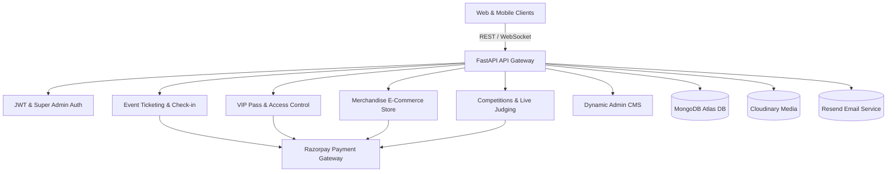

# Eventora — Event Management Platform Backend


Eventora is a high-performance, enterprise-ready backend for a comprehensive event management, ticketing, VIP access, competitive esports/creative contests, and merchandise e-commerce platform. Built with **FastAPI**, **MongoDB Atlas (Motor Asyncio)**, and **Razorpay Payment Gateway**, it powers end-to-end workflows from dynamic CMS management to real-time QR gate check-ins and cryptographic transactions.

---

## 🚀 System Architecture & Key Modules



---

## 🌟 Core Features

### 1. 💳 Unified Razorpay Payment Gateway Integration
- **Zero Hardcoding Security:** Strictly loads API credentials from `.env` (`RAZORPAY_KEY_ID`, `RAZORPAY_KEY_SECRET`, `PAYMENT_WEBHOOK_SECRET`).
- **Comprehensive Coverage:** Native payment integration across:
  - 🎟️ **Event Ticket Bookings** (`/api/payments/*`)
  - 👑 **VIP Pass Bookings** (`/api/vip/*`)
  - 🛍️ **Merchandise Purchases** (`/api/merchandise/*`)
  - 🏆 **Paid Competition Registrations** (`/api/v1/competitions/*`)
  - 🎓 **Course & Workshop Registrations** (`/api/registrations/*`)
- **Authoritative Cryptographic Verification:** Dual-layer security featuring HMAC SHA-256 digital signature validation on client callbacks (`verify-payment`) and resilient background Webhooks (`X-Razorpay-Signature`).
- **Idempotency & Fraud Prevention:** Guaranteed single-confirmation architecture preventing duplicate bookings or forged transaction receipts.

---

### 2. 👑 VIP Pass & Special Access Control System
- **Tiered VIP Management:** Configure custom access tiers (*VIP, VVIP, Backstage, Artist Lounge, Meet & Greet, All-Access*).
- **Atomic Capacity Control:** Guaranteed zero-oversell seat allocation using atomic MongoDB queries.
- **Cryptographic QR Passes:** Generates tamper-proof QR verification tokens with high-resolution QR image generation.
- **Gate Entry Control:** Dedicated scanner verification endpoint (`POST /api/admin/vip-passes/verify`) with area restriction enforcement and duplicate scan rejection.

---

### 3. 🛍️ Event Merchandise E-Commerce System
- **Product Catalog Management:** Products with multi-size, multi-color variants, SKU tracking, pricing, and category filters.
- **Atomic Stock Reservation:** Temporarily reserves stock during checkout and automatically commits inventory upon successful payment confirmation.
- **Fulfillment Lifecycle:** Complete status workflow (*PENDING_PAYMENT ➔ PAID ➔ PROCESSING ➔ SHIPPED ➔ DELIVERED / CANCELLED*).
- **Courier & Tracking Timeline:** Real-time user tracking endpoint (`GET /api/merchandise/orders/{order_id}/tracking`).
- **Admin Inventory Control:** Low-stock alerts, manual stock adjustments with movement audit logging, and revenue analytics.

---

### 4. 🏆 Advanced Competitions & Live Judging
- **Dynamic File Submissions:** Multi-field submissions for images, audio, video, documents, portfolio links with size and format validation.
- **Submission Gate:** Strictly enforces that paid competitions require confirmed registration before accepting contest submissions.
- **Judge Management & Scoring:** Secure PIN-based judging sessions, conflict-of-interest skips, and weighted criteria scoring.
- **Leaderboards & Ties:** Dynamic score aggregation, tie-breaker handling, and public rank publishing.

---

### 5. 🎟️ Event Booking & QR Ticketing
- **Oversell Protection:** MongoDB atomic operators ensure tickets are strictly allocated within venue capacity limits.
- **Instant vs Paid Flow:** Free event tickets are instantly confirmed; paid tickets require verified payment.
- **QR Check-in System:** Dedicated mobile/web staff gate check-in scanners with duplicate scan prevention.

---

### 6. 🛡️ Dynamic Website Content Management (Admin CMS)
- **Single Super Admin Bootstrap:** Bootstrapped securely from `.env` credentials with Bcrypt password hashing.
- **Live Event Streams:** Private stream URL hiding from unauthenticated public APIs.
- **Banners, Testimonials & Links:** Fully dynamic reordering, approval, and publication workflows.
- **Recycle Bin & User Recovery:** 7-day TTL soft-deleted user recovery with automatic email aliasing.

---

## 🛠️ Technology Stack

| Component | Technology |
| :--- | :--- |
| **Backend Framework** | [FastAPI](https://fastapi.tiangolo.com/) (Python 3.12+) |
| **Database** | [MongoDB Atlas](https://www.mongodb.com/atlas) with Motor (Asyncio) |
| **Payment Gateway** | [Razorpay Python SDK](https://razorpay.com/) (v2.0.1+) |
| **Authentication** | PyJWT, Passlib (Bcrypt), OAuth2 Password Bearer |
| **Rate Limiting** | SlowAPI (Redis / In-Memory token bucket) |
| **File & Media Storage** | Cloudinary REST API |
| **Email Service** | Resend API |
| **PDF Generation** | ReportLab Native PDF Generator |
| **Package Manager** | `uv` (Astral) |

---

## ⚙️ Installation & Setup

### 1. Clone the repository
```bash
git clone https://github.com/ulmind-com/Event_Management_Backend.git
cd Event_Management_Backend
```

### 2. Install dependencies with `uv`
```bash
uv sync
```

### 3. Environment Variables Configuration
Create a `.env` file in the project directory:

```env
# Database Configuration
MONGODB_URI=mongodb+srv://<username>:<password>@cluster.mongodb.net/eventora?retryWrites=true&w=majority

# Razorpay Payment Gateway (Test or Live)
RAZORPAY_KEY_ID=rzp_test_TBRo7AUeaKIhKB
RAZORPAY_KEY_SECRET=9bJqOT5wotpt58O0Mal60miC
PAYMENT_PROVIDER=RAZORPAY
PAYMENT_GATEWAY_PROVIDER=RAZORPAY
PAYMENT_WEBHOOK_SECRET=9bJqOT5wotpt58O0Mal60miC

# Media Storage (Cloudinary)
CLOUDINARY_CLOUD_NAME=your_cloud_name
CLOUDINARY_API_KEY=your_api_key
CLOUDINARY_API_SECRET=your_api_secret

# Email Service (Resend)
RESEND_API_KEY=re_your_resend_api_key
MAIL_ADDRESS=noreply@yourdomain.com

# JWT & Security
SECRET_KEY=your_secure_random_jwt_secret_key_here
ALGORITHM=HS256
ACCESS_TOKEN_EXPIRE_MINUTES=30
ADMIN_TOKEN_EXPIRE_MINUTES=60
CORS_ORIGINS=*

# Super Admin Initial Credentials
SUPER_ADMIN_EMAIL=admin@eventora.com
SUPER_ADMIN_PASSWORD=your_super_admin_password
```

> [!IMPORTANT]
> The `.env` file is strictly ignored by `.gitignore` (`**/.env`). Never commit credentials to version control.

---

## 🏃‍♂️ Running the Server

Start the FastAPI application with Uvicorn:

```bash
uv run uvicorn app.main:app --reload --port 8000
```

- **Interactive Swagger Documentation:** [http://127.0.0.1:8000/docs](http://127.0.0.1:8000/docs)
- **ReDoc Documentation:** [http://127.0.0.1:8000/redoc](http://127.0.0.1:8000/redoc)
- **OpenAPI JSON Specification:** [http://127.0.0.1:8000/openapi.json](http://127.0.0.1:8000/openapi.json)

---

## 🔑 Initializing the Super Admin

1. Ensure `SUPER_ADMIN_EMAIL` and `SUPER_ADMIN_PASSWORD` are configured in `.env`.
2. Open Swagger UI at `/docs`.
3. Call `POST /api/admin/bootstrap`.
4. Log in using `POST /api/admin/login` to obtain an admin JWT access token.
5. Click the 🔓 **Authorize** button in Swagger UI and paste `Bearer <token>` to access privileged endpoints.

---

## 💳 Payment & Webhook Endpoints Quick Reference

| Method | Endpoint | Description |
| :--- | :--- | :--- |
| `POST` | `/api/payments/verify-razorpay` | Client verification for ticket bookings after Razorpay checkout |
| `POST` | `/api/payments/create-order/{booking_id}` | Generate or re-fetch Razorpay order for ticket booking |
| `POST` | `/api/payments/webhook` | Unified Razorpay webhook for tickets, competitions, and activities |
| `POST` | `/api/vip/verify-payment` | Client verification for VIP pass purchase |
| `POST` | `/api/vip/payments/webhook` | Webhook receiver for VIP pass confirmations |
| `POST` | `/api/merchandise/orders` | Place merchandise order & create Razorpay checkout order |
| `POST` | `/api/merchandise/orders/verify-payment` | Client verification for merchandise checkout |
| `POST` | `/api/merchandise/payments/webhook` | Webhook receiver for merchandise order completion |
| `POST` | `/api/v1/competitions/{comp_id}/verify-payment` | Client verification for paid competition registrations |
| `POST` | `/api/registrations/verify-payment` | Client verification for general paid activities |

---

## 🧪 Testing

Execute automated unit and integration tests using `pytest`:

```bash
# Run merchandise test suite
uv run pytest tests/test_merchandise_system.py -v

# Run VIP access test suite
uv run pytest tests/test_vip_system.py -v

# Run all test suites
uv run pytest -v
```

---

## 📄 License
Proprietary — All rights reserved © Eventora Platform.
